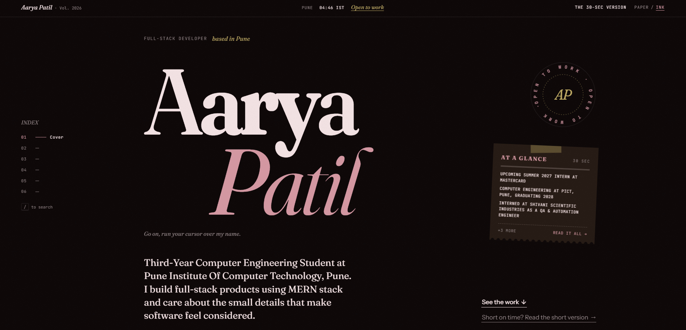
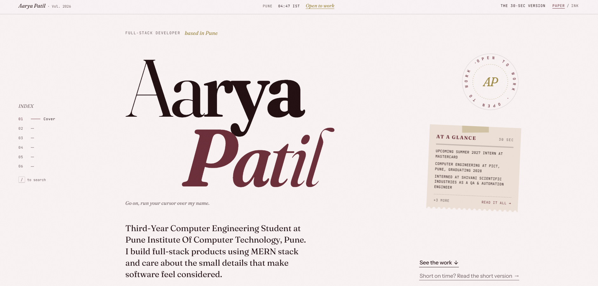

# Aarya Patil · Portfolio

**Live site:** [YOUR-LIVE-URL](YOUR-LIVE-URL)

I'm a third-year Computer Engineering student at PICT, Pune, and an incoming Summer 2027 Intern at Mastercard. This repository is my portfolio, and it's also a working full-stack application that I designed and built from scratch on the MERN stack.

## Why I built it this way

Most portfolios come from the same few templates: a grid of cards, a skill bar, a contact button. I wanted mine to show how I think about building software, not only list what I've built.

So I treated it like a product:

- **It has a real backend.** The guestbook and contact form store data in MongoDB, and letters are forwarded to my inbox. It isn't a static page.
- **It respects a recruiter's time.** There's a 30-second summary ("At a Glance") one click away from anywhere on the site, plus a keyboard shortcut (`/`) to jump to any section.
- **It's designed, not templated.** No UI kit or component library. The layout, interactions and both themes (Ink and Paper) are written by hand.

## What's on the site

| Section | What it shows |
| --- | --- |
| **Cover** | My name set in a variable font that reacts to the cursor, plus an "open to work" seal |
| **Exhibits** | Projects, starting with [Sahayog](https://she-solves3-0-sahayog.vercel.app/), a field workforce platform for NGOs with face-recognition attendance and GPS geo-fencing |
| **Logbook** | Internship and education, as expandable entries |
| **Toolkit** | The tools I use daily, am comfortable with, and am learning now |
| **The Margin** | A public guestbook where visitors leave notes for future visitors |
| **Letter** | A contact form written as a letter, delivered to my inbox |

## A look at both themes

<p align="center">
  
  
</p>
<p align="center"><sub>Ink (dark, the default) and Paper (light)</sub></p>

## Engineering highlights

- **Single source of content.** Everything on the site comes from one file (`content/content.js`). The server mirrors it into MongoDB on startup, and the frontend bundles it as a fallback, so the page renders instantly even if the API is slow.
- **Resilient by default.** If the database is unavailable, the server falls back to in-memory storage instead of crashing.
- **Abuse protection.** Rate limiting on the guestbook and contact endpoints, input sanitisation, and honeypot fields to catch bots.
- **Email forwarding.** Every letter is saved to MongoDB and sent to my Gmail via Nodemailer, with the sender set as reply-to, so I can answer with one click.
- **Admin endpoints.** Token-protected routes to read letters and remove guestbook notes.
- **Accessibility and performance.** Responsive down to small phones, keyboard navigable, honours "reduced motion" settings, and pauses animations that are off-screen.

## Tech stack

**Frontend:** React, Vite, hand-written CSS (no UI framework), Simple Icons
**Backend:** Node.js, Express, Mongoose, Nodemailer, express-rate-limit
**Database:** MongoDB Atlas
**Fonts:** Fraunces, Instrument Sans, JetBrains Mono

## Project structure

```
content/    content.js: every word, project and skill on the site
client/     React frontend (Vite)
server/     Express API: content, guestbook, letters, admin routes
```

## Run it locally

```bash
npm run setup      # installs root, server and client dependencies
npm run dev        # API on :5000, site on http://localhost:5173
```

To store data and receive letters, copy `server/.env.example` to `server/.env` and fill in `MONGODB_URI`, `GMAIL_USER`, `GMAIL_APP_PASSWORD` and `ADMIN_TOKEN`. Without these, the site still runs, using in-memory storage.

## Deploy

One service (for example on Render):

- Build command: `npm run build`
- Start command: `npm start`
- Environment variables: the same as `server/.env`

## Contact

[LinkedIn](https://www.linkedin.com/in/aarya-patil-735472315/) · [GitHub](https://github.com/PatilAarya) · aaryapatil5445@gmail.com

Or leave a note in the Margin on the live site. I read every one.
